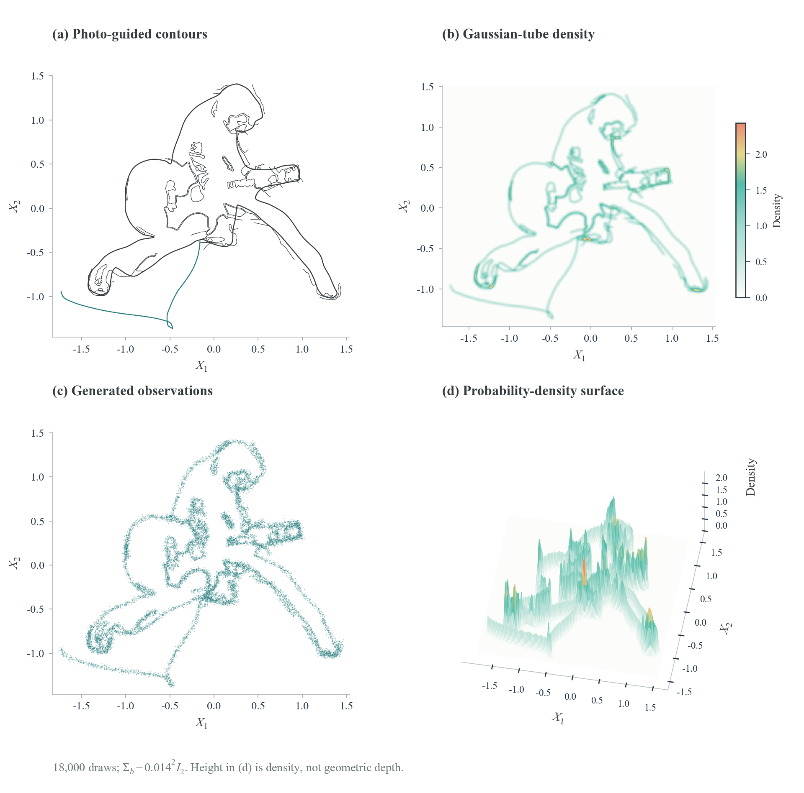
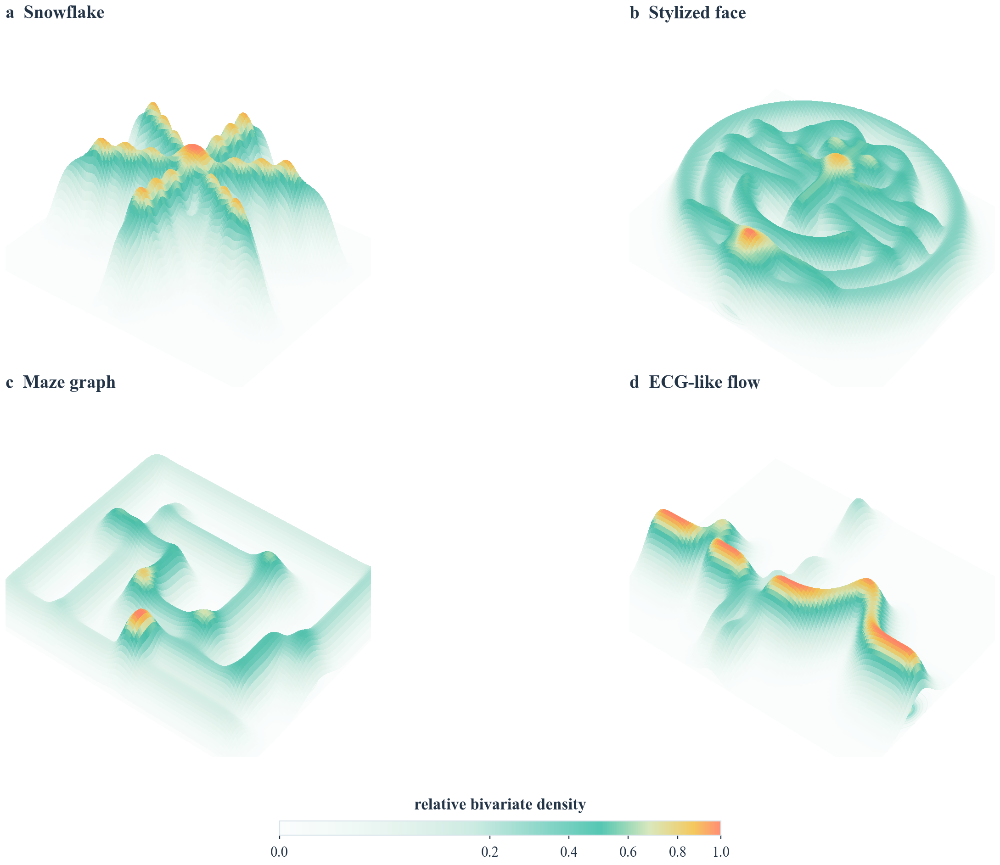
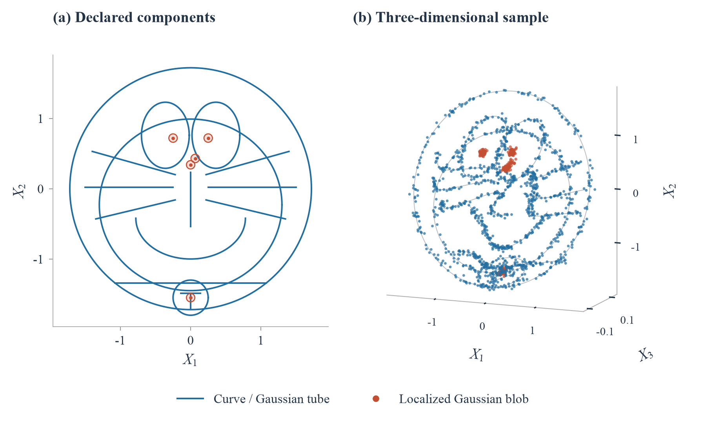
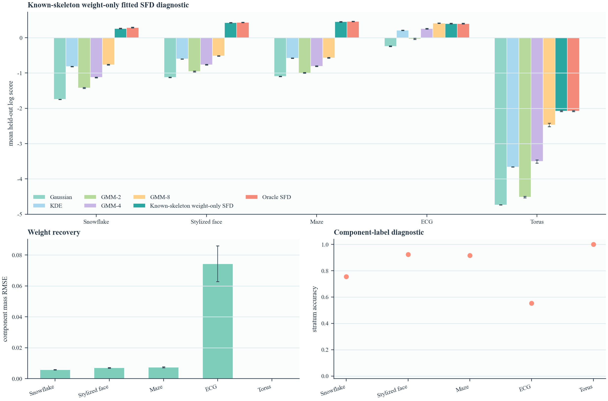

<div align="center">

# Stratified Flow Distributions

**Mixed-support density models with explicit strata**

[](https://github.com/ElvisCuiHan/stratified-flow-distributions/actions/workflows/tests.yml)

[](LICENSE)

[Paper](paper/sfd_preprint.pdf) · [Reproduce](docs/REPRODUCING.md) · [Figure Index](docs/FIGURES.md) · [Python API](docs/API.md)

Elvis Han Cui · UCLA / Kuntuo, an IQVIA Company

</div>

SFD combines point masses, distributions along declared branches, Gaussian
tubes, and residual densities in one probability law. Component mass,
position along a branch, and transverse width describe different features
of the observed distribution.

## A Shape Is a Probability Law

<table>
<tr>
<td width="50%" align="center"><b>Elvis: contours to density</b></td>
<td width="50%" align="center"><b>Doraemon and other declared geometries</b></td>
</tr>
<tr>
<td></td>
<td></td>
</tr>
</table>

These are **specified-law illustrations**, not fitted reconstruction results.
The surface height represents density, not an extra observed coordinate.
The Elvis reference photo is not included. Photo-derived and recognizable
character elements have separate [rights notices](THIRD_PARTY_NOTICES.md)
and are not covered by the code license.

<details>
<summary>Doraemon-inspired components and a three-dimensional sample</summary>



Here the third axis is an observed coordinate. Curves carry Gaussian tubes;
localized Gaussian blobs remain continuous components.

</details>

## Try It

```bash
git clone https://github.com/ElvisCuiHan/stratified-flow-distributions.git
cd stratified-flow-distributions
python -m venv .venv
source .venv/bin/activate
python -m pip install -e '.[reproduce,test]'
python reproduce.py verify
python reproduce.py smoke --out runs/smoke
```

```python
from flowdistribution import cartoon_face

law = cartoon_face()
x = law.rvs(1000, random_state=42)
log_density = law.logpdf(x, n_grid=64)
membership = law.responsibilities(x, n_grid=64)
```

The package evaluates continuous tube integrals by numerical quadrature.
Use `law.discretize(n_grid=64)` when sampling and density evaluation must
refer to the same finite midpoint approximation. See the [API notes](docs/API.md).

## Actual Fitted-SFD Results



This comparison fits **component weights only**, with the generating skeleton,
within-branch coordinate laws, and kernel parameters supplied. It uses five
scenarios, 25 repetitions, and 1,000 training / 1,000 test observations.
Bars show one Monte Carlo standard error. It does not establish recovery
of unknown geometry or tube widths.

The other experiments separate mass, position and width changes; perturb
the supplied geometry; and test training-fitted representations on public
PBMC3k data. The PBMC analysis uses overlapping cell splits from one collection,
not independent donors. Classical-distribution and copula comparisons are
controls without a fitted SFD. All are indexed in [Reproducing the Paper](docs/REPRODUCING.md).

## Reproduction Levels

| Command | Operation | New fits / downloads |
|:--|:--|:--|
| `python reproduce.py verify` | Check archived scores and interval counts | Neither |
| `python reproduce.py figures --out runs/figures` | Redraw fitted comparison and appendix controls | Neither |
| `Rscript scripts/plot_sfd_evidence.R runs/r-figures` | Redraw three main results figures | Neither |
| `python reproduce.py elvis --out runs/elvis` | Rebuild the Elvis illustration from released contours | Neither |
| `python reproduce.py smoke --out runs/smoke` | Small deterministic weight-fitting experiment | Fits only |
| `python reproduce.py fit known --out runs/known` | 25-repeat known-skeleton comparison | Long fitting run |
| `python reproduce.py fit mechanism --out runs/mechanism` | 25-repeat mechanism experiment | Long fitting run |
| `python reproduce.py fit geometry --out runs/geometry` | 25-repeat geometry/noise stress test | Long fitting run |
| `python reproduce.py fit pbmc --raw data/pbmc3k.tar.gz --out runs/pbmc` | 25-split PBMC analysis | Fits; raw data required |
| `python reproduce.py paper` | Compile the included 34-page preprint | LaTeX required |

Full runs are opt-in; verification and CI never start them. Frozen scores are
retained independently of new runs. Exact font rendering and numerical
optimization can vary across platforms. The [reference environment](environment.yml)
records the original numerical-library versions.

## Repository

```text
src/flowdistribution/   Probability laws, quadrature, fitting utilities
scripts/               Experiment and figure implementations
evidence/              Frozen per-repetition results for main figures
paper/                 Preprint PDF, LaTeX, figure PDFs, checked tables
data/derived/          Released Elvis contour geometry; no reference photo
docs/                  Reproduction guide, figure map, API, source notices
tests/                 Numerical and release-integrity tests
```

## Citation and License

```bibtex
@misc{cui2026sfd,
  author = {Cui, Elvis Han},
  title = {Stratified Flow Distributions: Mixed-Support Density Models with Explicit Strata},
  year = {2026},
  howpublished = {Preprint and accompanying software},
  url = {https://github.com/ElvisCuiHan/stratified-flow-distributions}
}
```

Original software is [MIT licensed](LICENSE). Author-owned manuscript text
and numerical evidence use CC BY 4.0, subject to the
[material-specific exclusions](THIRD_PARTY_NOTICES.md). Document styles
retain their upstream licenses. The accompanying manuscript is an author
preprint; its publication metadata will be updated when available.
